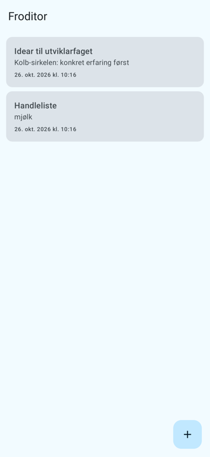
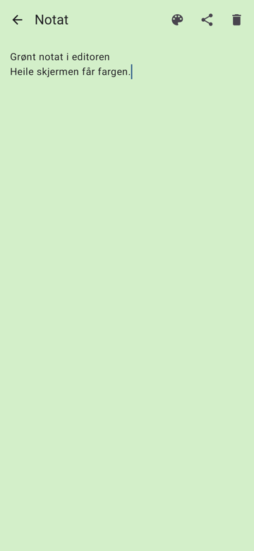
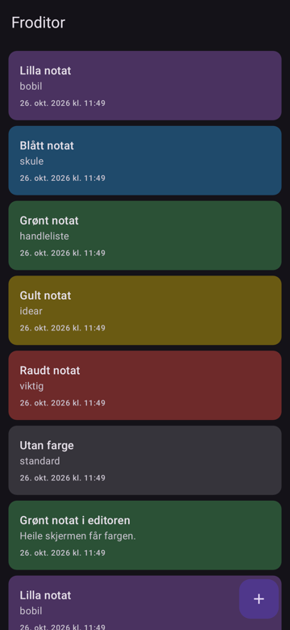

# Froditor for Android

Ein enkel notatapp for Android, i same ånd som [Froditor for Linux](https://github.com/Frodolini/Froditor).
Ingen konto, ingen sky og ingen reklame: notata er vanlege `.txt`-filer på telefonen.

<p>
  
  
  
</p>

## Funksjonar (versjon 1.1)

- Liste over notat, nyaste først, med tittel (første linje), førehandsvising og dato
- Skriv nytt notat med **+**
- Automatisk lagring medan du skriv, og når du går ut av appen
- Del eit notat (e-post, meldingar o.l.)
- Slett notat (med stadfesting)
- **Fargar på notat** (nytt i 1.1): vel mellom 8 fargar med palett-knappen. Fargen blir vist på
  kortet i lista og som bakgrunn i heile editoren, og er tilpassa både lyst og mørkt tema
- Tomme notat blir ikkje lagra
- Lyst og mørkt tema, fargar frå telefonen på Android 12+
- Krev Android 8.0 eller nyare

## Installere

1. Last ned `Froditor-x.y.apk` frå [Releases](../../releases).
2. Opne fila på telefonen og tillat installasjon frå denne kjelda når telefonen spør.

### Automatiske oppdateringar med Obtainium

1. Installer [Obtainium](https://github.com/ImranR98/Obtainium) (éin gong).
2. Trykk **Add App** og lim inn adressa til dette repoet:
   `https://github.com/Frodolini/Froditor-Android`
3. Obtainium varslar når det kjem ein ny versjon, og installerer med eitt trykk.

Oppdateringar held på alle notata.

## Byggje sjølv

Opne mappa i **Android Studio** og trykk ▶ Run. Eller frå kommandolinja:

```bash
./gradlew testDebugUnitTest   # køyr testane
./gradlew assembleDebug       # byggjer app/build/outputs/apk/debug/app-debug.apk
./gradlew assembleRelease     # signert versjon (krev keystore.properties, sjå under)
```

Signert release-bygg krev fila `keystore.properties` i rotmappa (ligg **ikkje** i repoet):

```properties
storeFile=/sti/til/froditor-release.jks
storePassword=...
keyAlias=froditor
keyPassword=...
```

Ved ny versjon: auk `versionCode` (og `versionName`) i `app/build.gradle.kts`.

## Korleis prosjektet heng saman

| Fil | Kva han gjer |
|---|---|
| `app/build.gradle.kts` | Byggjeoppsett: namn, versjon, Android-versjonar, bibliotek, signering |
| `gradle/libs.versions.toml` | Alle bibliotek og versjonar samla på éin stad |
| `app/src/main/AndroidManifest.xml` | «Visittkortet» til appen: namn, ikon, kva som startar |
| `MainActivity.kt` | Inngangen til appen; vel mellom lista og editoren |
| `ui/NotesViewModel.kt` | Held på tilstanden (notat, opent notat, tekst) og lagrar automatisk |
| `ui/NoteListScreen.kt` | Skjermbiletet med lista |
| `ui/EditorScreen.kt` | Skjermbiletet der du skriv |
| `ui/theme/Theme.kt` | Fargar og lyst/mørkt tema |
| `ui/NoteColorUi.kt` | Fargeveljaren og koplinga mellom notatfarge og skjermfarge |
| `data/NoteColors.kt` | Dei 8 notatfargane, og `ColorStore` som hugsar fargane i `colors.properties` |
| `data/NoteRepository.kt` | Les og skriv `.txt`-filer. Veit ingenting om Android |
| `res/values/strings.xml` | All tekst i appen (nynorsk) |
| `src/test/...` | Testar: lagring og fargar (JUnit) og heile brukarflyten (Robolectric) |

## Versjonar

- **1.1.1**: Grøn tittellinje, som i Froditor for Linux
- **1.1**: Fargar på notat
- **1.0**: Første versjon

Appen er skriven i **Kotlin** med **Jetpack Compose**, som er dagens standard for Android-appar.
